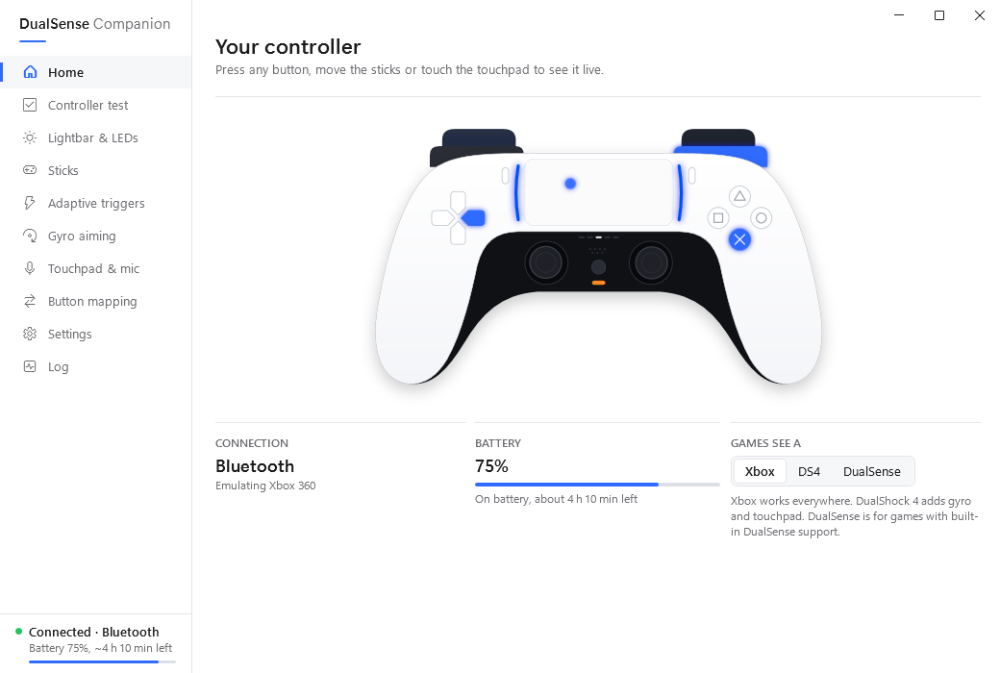
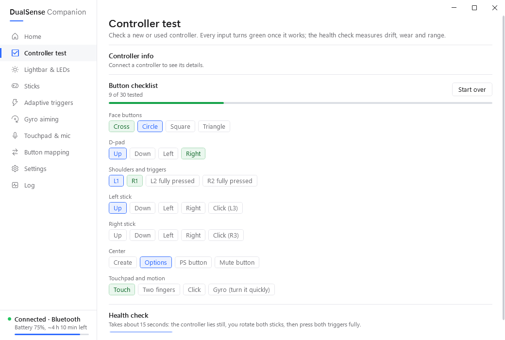
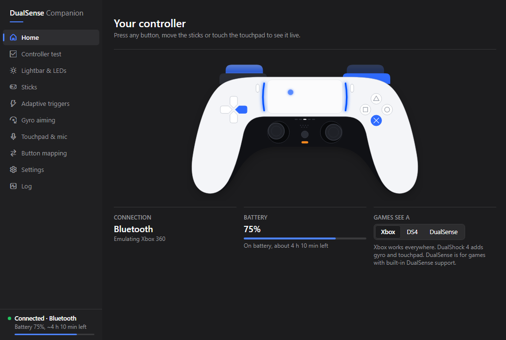
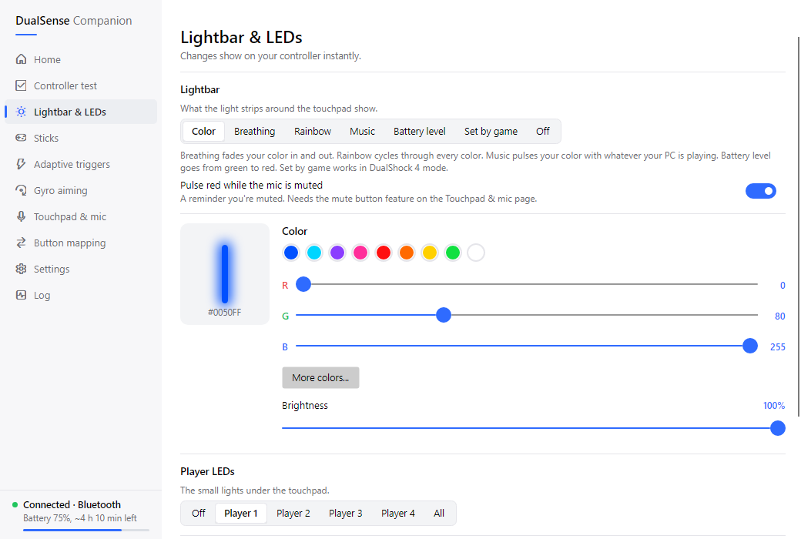
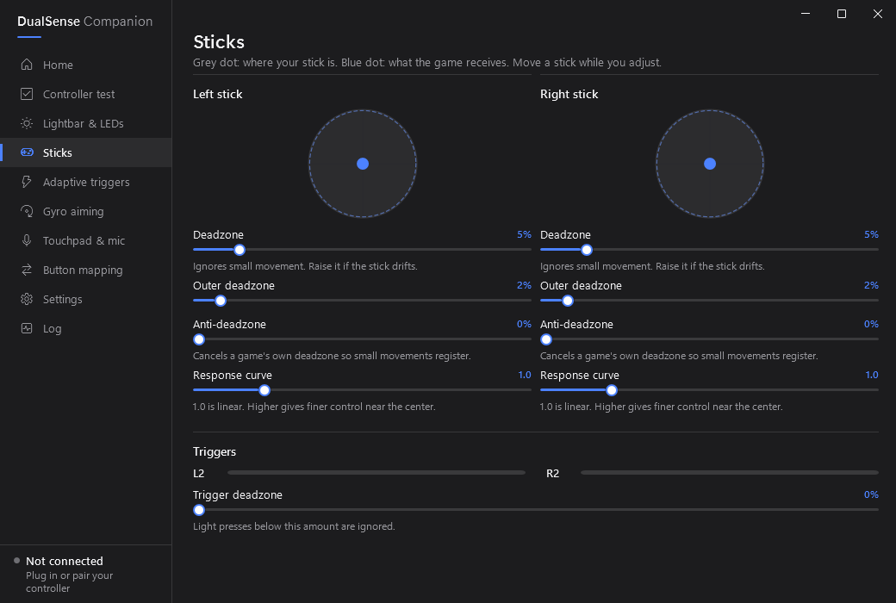

# DualSense Companion

A companion app for the DualSense (PS5) controller on Windows. It lets you play almost every PC game with your PS5 controller and unlocks DualSense features like gyro aiming, adaptive triggers and the lightbar.

The app window shows a live view of your controller that lights up as you press buttons, plus pages for the lightbar, sticks, adaptive triggers, gyro, touchpad, button mapping and settings. Changes apply instantly and are saved automatically.

Closing the window keeps the app running in the system tray so your controller keeps working. Click the tray icon to open the window again, or right-click it for quick actions and **Exit**.



<table>
  <tr>
    <td></td>
    <td></td>
  </tr>
  <tr>
    <td></td>
    <td></td>
  </tr>
</table>

## Getting started

1. Download `DualSenseCompanion.exe` from the [latest release](https://github.com/dchosendave/DualSenseCompanion/releases/latest). It's a single file and doesn't need .NET installed.
2. Run it. On first start it offers to install the two drivers it needs, **ViGEmBus** (creates the virtual controller) and **HidHide** (hides the real one so games don't see two). HidHide needs a restart.
3. Connect your controller with a USB cable or Bluetooth. Press buttons on the **Home** page to check that everything responds.
4. Optional: **Settings > Self-test** checks input and confirms the controller accepts lightbar, rumble and trigger commands.

## What games see

| Mode | Use it for |
|---|---|
| **Xbox 360** (default) | Almost every PC game. |
| **DualShock 4** | Games, emulators and Steam Input that support PlayStation controllers. Shows PlayStation button prompts and passes gyro, accelerometer and touchpad through natively. |
| **Native DualSense** | Games with built-in DualSense support (haptics, their own trigger effects). No virtual controller is created and the real controller stays visible. The app stops sending lightbar, trigger and rumble updates so it doesn't fight the game; changes you make in the app are still sent once. |

The virtual controller driver (ViGEmBus) can only create Xbox 360 and DualShock 4 controllers, which is why there is no emulated DualSense mode.

## Features

**DualSense features**
- **Gyro aiming**: as mouse movement (best precision) or added to the right stick (works in every game). Always on, while holding a button, or toggled. Adjustable sensitivity and steadiness, invert, turn or tilt for horizontal aim, automatic drift correction and calibration, with a live motion readout.
- **Adaptive triggers**: soft, medium or hard resistance, weapon-style click, or vibration, separately for L2 and R2.
- **Lightbar**: custom color, breathing, rainbow, music (pulses with your PC's sound), battery level (green to red), set by the game (DualShock 4 mode) or off, with brightness control. Optional red pulse while the mic is muted.
- **Player LEDs**: player 1-4 or all.
- **Battery**: shown in the app and tray with an estimate of the time left; low-battery notification and red pulsing lightbar.
- **Mic mute button**: mutes and unmutes all Windows microphones, with the button LED showing the state.
- **Touchpad as mouse**: one finger moves the pointer, click is left click, two-finger click is right click, two-finger drag scrolls.
- **Rumble** with adjustable strength and a test button.

**Controller test**
- Button checklist: every button, trigger, stick direction, touchpad input and the gyro turns green once it works.
- Health check: measures stick drift, stick jitter, stick range, trigger travel and gyro noise, with advice when something is off.
- Controller info: model, Bluetooth address, firmware and hardware versions.

**Tuning**
- Stick deadzone, outer deadzone, anti-deadzone and response curve per stick, with a live plot of the physical stick and what the game receives.
- Trigger deadzone.
- Button remapping.

**App**
- Light and dark mode, following Windows by default.
- Keyboard navigation (Tab, arrow keys within option groups, Ctrl+1 to Ctrl+0 for pages) and screen-reader names for every control.

**Reliability**
- USB and Bluetooth, DualSense and DualSense Edge.
- Automatic reconnect when you unplug, switch between USB and Bluetooth, or the battery dies.
- The real controller is hidden only while the app runs. It is restored on exit, logoff and crashes; if the app is force-closed, it is restored the next time the app starts.
- Built-in self-test.
- Warns about setups that cause double input: other controller apps (DS4Windows, DSX, reWASD, x360ce), Steam's PlayStation support in DualShock 4 mode, or HidHide missing.
- Starts with Windows (optional, starts in the tray).
- Checks GitHub for a newer release on startup (can be turned off in Settings; nothing about you or your PC is sent).

## Command line

| Command | Effect |
|---|---|
| `DualSenseCompanion.exe` | Starts the app, or opens the window of the copy that's already running. |
| `DualSenseCompanion.exe --minimized` | Starts in the tray (used by Start with Windows). |
| `DualSenseCompanion.exe --exit` | Closes the running copy cleanly. |

## Settings file

Settings are stored in `%AppData%\DualSenseCompanion\settings.json`. Everything can be changed in the app; to edit the file by hand use **Settings > Open settings file**, save, then **Reload settings file**.

```jsonc
"LeftStick": {
  "Deadzone": 0.05,       // ignore movement below 5% (stick drift)
  "OuterDeadzone": 0.02,  // reach 100% slightly before the edge
  "AntiDeadzone": 0.0,    // minimum output once you move (counters in-game deadzones)
  "Curve": 1.0            // 1 = linear, 2 = finer aim near the center
},
"TriggerDeadzone": 0.0,
"ButtonMap": {
  "Cross": "A",
  "Circle": "B",
  "Mute": "None"          // used by the mic feature unless that is turned off
}
```

`ButtonMap` keys (DualSense): `Cross, Circle, Square, Triangle, L1, R1, L3, R3, Create, Options, PS, DpadUp, DpadDown, DpadLeft, DpadRight, Touchpad, Mute`.
Values (virtual controller): `A, B, X, Y, LeftShoulder, RightShoulder, LeftThumb, RightThumb, Back, Start, Guide, Up, Down, Left, Right, Touchpad` (DualShock 4 only) or `None`. In DualShock 4 mode A/B/X/Y are Cross/Circle/Square/Triangle, Back is Share and Start is Options.

## Troubleshooting

- **Something doesn't work**: run **Settings > Self-test** and check the **Log** page. The log is in `%AppData%\DualSenseCompanion\log.txt`; the previous run's log is kept as `log.old.txt`.
- **Controller missing in other apps**: start DualSense Companion once and exit it from the tray; it restores anything left hidden. You can also remove it in the HidHide Configuration Client.
- **Games see two controllers**: HidHide isn't installed or wasn't restarted after installing.

## Building

Requires the .NET 8 SDK (or newer) on Windows.

The solution has three projects:

- `DualSenseCompanion.Core`: controller input and output, emulation, features, settings and drivers. No UI.
- `DualSenseCompanion`: the app window and tray icon, built with [Avalonia](https://avaloniaui.net/) and its Fluent theme.
- `DualSenseCompanion.Tests`: unit tests for Core.

```
dotnet build
dotnet test
```

Release build, a single self-contained `DualSenseCompanion.exe`:

```
dotnet publish DualSenseCompanion -c Release -p:SingleFile=true -o publish
```

GitHub Actions builds and tests every push and pull request and uploads the `.exe` as an artifact. Pushing a tag such as `v1.1.0` publishes a GitHub release with the `.exe` attached.

## Roadmap

1. Support for up to 4 controllers.
2. Headphone jack support for game audio.

## Thanks

1. ViGEm (Virtual Gamepad Emulation Driver): the virtual Xbox 360 and DualShock 4 controllers.
2. HidHide: hiding the real controller from games.
3. HidSharp: HID device communication in C#.
4. Avalonia: the app's interface (Fluent theme).
5. Fluent UI System Icons (Microsoft, MIT): the sidebar icons. See [THIRD-PARTY-NOTICES.md](THIRD-PARTY-NOTICES.md).
6. Linux kernel (hid-playstation.c): DualSense protocol documentation.
7. NAudio: Windows microphone control.
8. Nielk1's trigger effect documentation: adaptive trigger effect formats.
9. The open-source community: shared knowledge on DualSense input and output.

Not affiliated with Sony Interactive Entertainment.
